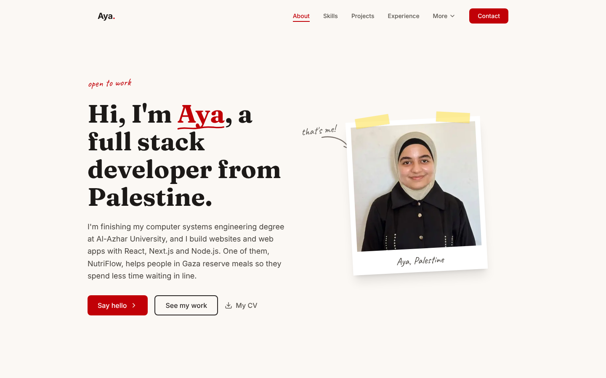
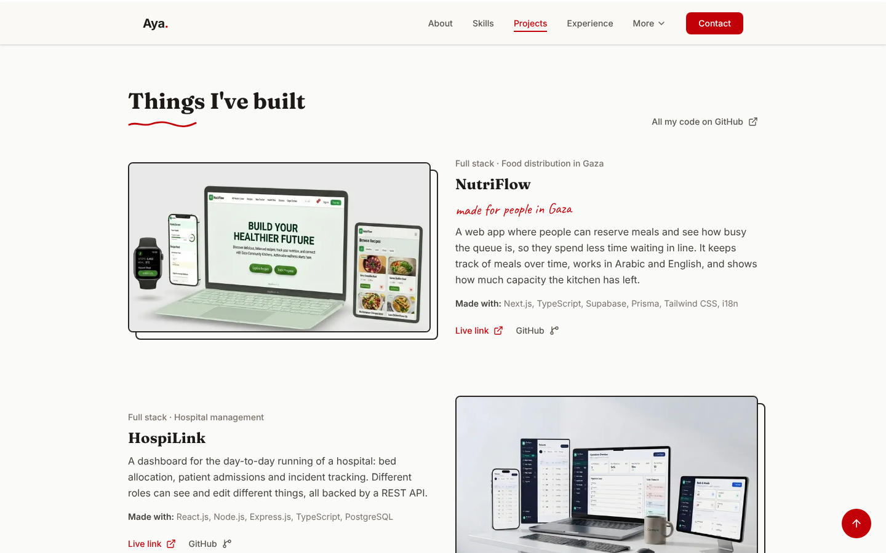
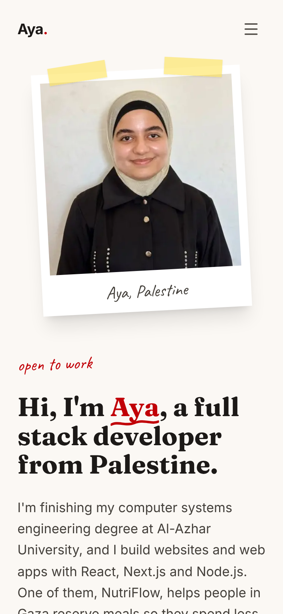

# Aya Almadhon: Portfolio

**My personal portfolio: who I am, what I have built, where I have worked and how to reach me.**

**Live:** [portfolio-of-aya.vercel.app](https://portfolio-of-aya.vercel.app)



## What is on the site

| Section | What you will find |
|---|---|
| **About** | Who I am, where I study (Al-Azhar University) and what I build, with a download link for my CV. |
| **Skills** | Grouped by area: frontend, state management, backend and database, DevOps, and performance and SEO. |
| **Projects** | The things I have built, each with a short story, the stack, a live link and the code. |
| **Experience** | Internships and jobs, newest first. |
| **Articles, Services, Contact** | Writing, what I can help with, and the easiest ways to reach me. |



## How it is built

A single-page portfolio on **Next.js 16 (App Router)** with **React 19** and **Tailwind CSS 4**, written in TypeScript.

- **Fast by default.** The page is pre-rendered at build time, fonts are loaded through `next/font`, and the scroll and reveal effects are small and live in one file (`app/components/Effects.tsx`).
- **SEO.** Page metadata, an Open Graph image, JSON-LD structured data, and a sitemap and `robots.txt` generated at build time with `next-sitemap`.
- **Considerate motion.** Animation is switched off for visitors who prefer reduced motion.
- **Responsive.** Designed to work from phones to wide desktop screens, with a navigation menu that adapts.

<p align="center">
  
</p>

## Tech stack

Next.js 16 · React 19 · TypeScript · Tailwind CSS 4 · lucide-react · Inter, Fraunces and Caveat fonts · next-sitemap · deployed on Vercel.

## Run it locally

```bash
git clone https://github.com/Ayaalmadhon2004/portfolio-of-aya-.git
cd portfolio-of-aya-
npm install
npm run dev        # http://localhost:3000
```

| Command | What it does |
|---|---|
| `npm run dev` | Development server |
| `npm run build` | Production build, then generates the sitemap |
| `npm start` | Serves the production build |
| `npm run lint` | ESLint |

## Project structure

```
app/
├── page.tsx                all sections and the content (projects, skills, experience)
├── layout.tsx              fonts, metadata, Open Graph and structured data
├── globals.css             theme colours and base styles
└── components/Effects.tsx  scroll and reveal effects
public/
├── assets/                 project screenshots and my photo
└── Aya-Almadhon-CV.pdf
```

To add a project, add an entry to the projects list in `app/page.tsx` and put its screenshot in `public/assets/`.

## Contact

[Email](mailto:aya.alaasel123@gmail.com) · [LinkedIn](https://linkedin.com/in/aya-almadhon2025) · [GitHub](https://github.com/Ayaalmadhon2004)
